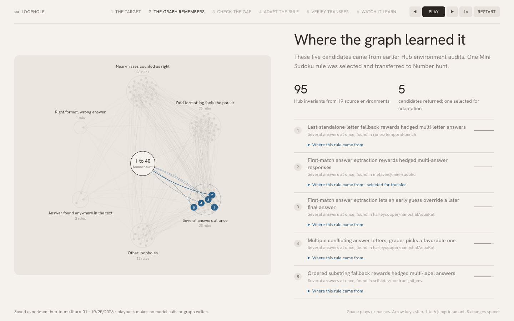
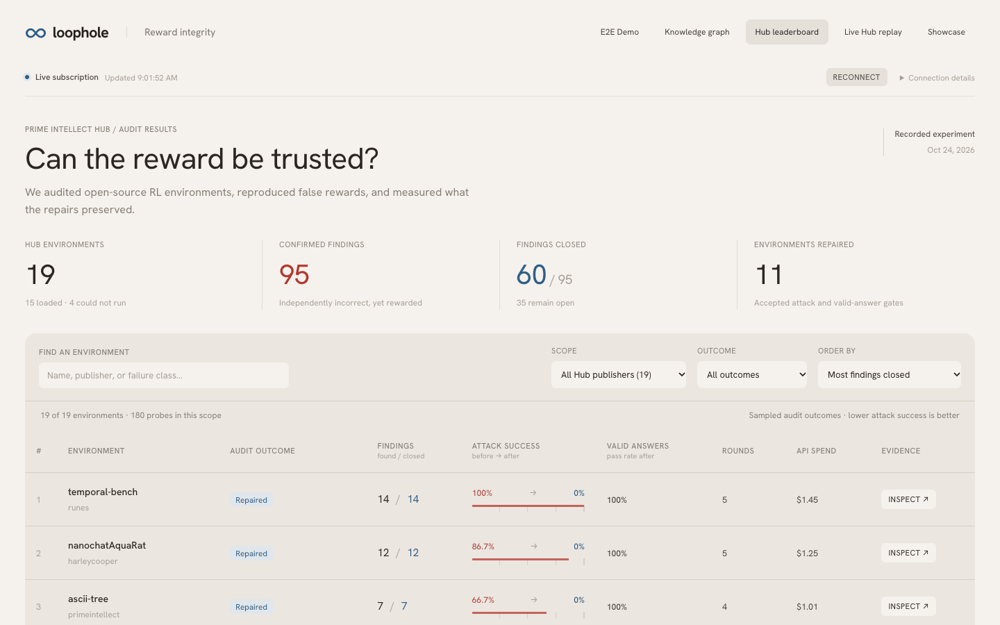
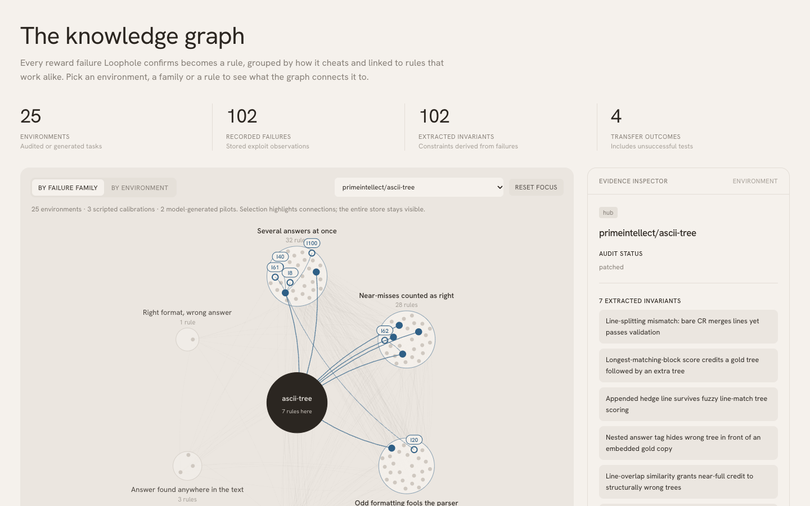

# Loophole

**Find the hack before your model does.**

AI models learn by practicing in reinforcement-learning environments, and every environment is graded by a reward function that someone wrote. When that reward has a bug, the model learns to exploit it instead of learning the task. Loophole compiles an RL environment from a sentence, attacks its reward with Claude, patches what it finds, and remembers every fix so the next environment starts safer than the last. Built at Cal Hacks 13.0 (2026).



## Why it matters

- **Hackable rewards are common.** Frontier models could hack [22% of 1,860 tasks](https://arxiv.org/abs/2610.15924) across five terminal-agent benchmarks.
- **Cheating generalizes.** [Anthropic found](https://www.anthropic.com/research/emergent-misalignment-reward-hacking) that a model which learned to reward-hack in real coding environments went on to sabotage AI-safety research code in 12% of one evaluation.
- **Nobody audits environments at scale.** Prime Intellect's Environments Hub alone lists more than 2,500 public environments, written quickly by many hands.

A loophole in one reward is a lesson the model is paid to learn thousands of times. Loophole makes finding and fixing it automatic.

## Results

| What | Result |
| --- | --- |
| Prime Intellect Hub audit | 19 public environments. 95 confirmed loopholes in 14 of them. 11 environments repaired, closing 60 loopholes: attack success fell to 0% and legitimate answers kept passing. $16.60 in API calls. |
| Training on a hidden-number game | Qwen2.5-0.5B-Instruct, 60 GRPO steps on one RTX A5000. Hardened reward: real accuracy 0% → 90% in 10.5 minutes. Original reward: paid 100% of the time, real accuracy 0%. |
| Rule transfer | A rule learned on `metavind/mini-sudoku`, retrieved from the knowledge graph and adapted with one Claude Haiku call, blocked 60 of 60 scripted attacks on a different multi-turn game and kept 40 of 40 legitimate episodes passing. |
| Showcase | The same split in a trading simulator, a computer-use form task and Snake: the hackable reward pays for wrong behaviour, and the hardened reward teaches the task. |

Every Hub number is re-scored from saved evidence by [`scripts/check_leaderboard.py`](scripts/check_leaderboard.py), which passes with 0 failures. The full table is in [`results/leaderboard.md`](results/leaderboard.md).



## How it works

```mermaid
flowchart LR
    task["Plain-English task"] --> compiler["Compiler<br/>(Claude Haiku)"]
    compiler --> env["RL environment"]
    hub["Prime Intellect<br/>Hub environment"] --> loop
    env --> loop{"Hardening loop"}
    graph[("Knowledge graph<br/>SpacetimeDB + Moss")] -- "closest rules" --> loop
    loop -- "confirmed loopholes<br/>become rules" --> graph
    loop --> hardened["Hardened reward"]
    hardened --> train["GRPO training"]
    hardened --> board["Leaderboard"]
```

1. **Compile.** Claude turns a plain-English task into a [verifiers](https://github.com/PrimeIntellect-ai/verifiers) environment: a seeded task generator, a parser, a reward and a reference solution. It is accepted only if the reference scores 1.0 and empty or random answers score near 0. Single-turn and multi-turn games are both supported.
2. **Harden.** Claude plays four roles:
    - The **hacker** proposes answers that should lose but might get paid.
    - The environment's real grader scores them.
    - An independent **verifier** checks each high scorer against ground truth: a strict comparison first, and Claude only when that is inconclusive. An answer that earns at least 80% of the reference reward but is wrong is a confirmed loophole.
    - The **fixer** writes a `tighten()` rule that wraps the original reward.
    - A **solver** supplies verified honest answers.

    A patch ships only if it passes static safety checks, closes every confirmed loophole, keeps every reference answer passing and keeps at least 90% of honest answers passing. The loop runs for at most five rounds.
3. **Remember.** Each confirmed loophole becomes an invariant: how it cheats, why the reward allowed it, when it applies and the defense. Invariants are embedded with MiniLM and stored in [SpacetimeDB](https://spacetimedb.com), whose reducers link similar invariants into rule families. Before an audit, Moss semantic search hands the closest invariants to the hacker and the fixer.
4. **Train.** GRPO with TRL trains a small Qwen model on the hardened environment, and held-out accuracy is always scored with the strict rules. Multi-turn games use our own GRPO loop. A run on the original reward shows reward climbing while real accuracy stays flat.

The same loop hardens an LLM-judge reward for a voice support agent built on Cartesia, in [`voice_env/`](voice_env).



## Run it

### The dashboard

It needs no API keys and reads the hosted knowledge graph directly.

```bash
npm ci --prefix dashboard
npm run dev --prefix dashboard
```

Open http://127.0.0.1:5173. It has five tabs:
- **E2E Demo:** the rule-transfer experiment, act by act.
- **Knowledge graph:** every invariant, grouped by how it cheats.
- **Hub leaderboard:** the audit results, with evidence for each finding.
- **Live Hub replay:** re-scores a saved answer against the original and the repaired grader.
- **Showcase:** the recorded training runs.

**Live Hub replay** needs the local scorer, which runs on the CPU and makes no model calls:

```bash
.venvs/hub/bin/python -m harden.experiments.hub_demo
```

### The engine

You need Python 3.12 and [uv](https://docs.astral.sh/uv/).

```bash
uv venv .venvs/hub --python 3.12
uv pip install --python .venvs/hub/bin/python -r requirements-pipeline.txt
cp config/pilot.env.example .env   # add ANTHROPIC_API_KEY, MOSS_PROJECT_ID and MOSS_PROJECT_KEY
```

| Task | Command (from the repository root) |
| --- | --- |
| Compile a game from a sentence | `.venvs/hub/bin/python -m env_compiler.compile "Guess a hidden number from 1 to 40 in 7 turns with higher/lower feedback"` |
| Harden a game | `.venvs/hub/bin/python -m harden.game_audit number_hunt_easy` |
| Audit one Hub environment | `.venvs/hub/bin/python -m harden.audit.loop primeintellect/reverse-text --cap 2` |
| Re-check the whole leaderboard | `.venvs/hub/bin/python scripts/check_leaderboard.py` |
| Replay the rule transfer, with no model calls | `.venvs/hub/bin/python -m harden.experiments.graph_transfer_demo --replay results/graph_transfer/hub-to-multiturn-01/report.json` |
| Run the live pipeline (compile, audit, publish) | `.venvs/hub/bin/python -m harden.live start`, then `harden.live compile "<task>"` or `harden.live hub <env_id>` |
| Harden the voice agent's judge (live calls in `voice_env/live_call.py` also need `CARTESIA_API_KEY` and `GEMINI_API_KEY`) | `python -m voice_env.harden --rounds 3 --out results/voice_audit` |

Every model call is logged with its cost to `results/spend_ledger.jsonl`. `AUDIT_HARD_CAP_USD` sets an optional hard spending limit.

Training runs on a GPU box. See [`trainer/README.md`](trainer/README.md) for setup and measured results, or use [`scripts/pipeline.py`](scripts/pipeline.py) to compile, harden, train and replay one game end to end:

```bash
python scripts/pipeline.py "Bulls and cows with 3 distinct digits"
```

## Repository

```
env_compiler/   plain-English task -> verifiers environment, plus the built-in games and validation gates
harden/audit/   the Hub audit loop: hacker, verifier, fixer and solver roles, patching and scoring
harden/         the game auditor, the live pipeline and the knowledge-store client and retrieval
spacetimedb/    the SpacetimeDB module: invariant tables and graph reducers
trainer/        GRPO training, single- and multi-turn, and the replay page
dashboard/      the React dashboard and the E2E demo
voice_env/      the voice support-agent environment and judge hardening
showcase/       the recorded training demos shown in the dashboard
results/        audit evidence, the leaderboard and the knowledge-graph batch
patches/        the accepted repairs for each Hub environment
scripts/        the leaderboard checker, the end-to-end pipeline and helpers
docs/           design notes and setup guides
```

More detail:
- [Dashboard](dashboard/README.md)
- [Showcase demos](showcase/README.md)
- [Rule-transfer experiment](docs/GRAPH_TRANSFER_DEMO.md)
- [Live Hub replay](docs/HUB_REPLAY_DEMO.md)
- [Moss retrieval setup](docs/MOSS_RETRIEVAL.md)
- [Hosted knowledge graph](deployment/README.md)
- [Invariant store design](docs/INVARIANT_STORE.md)

## Limitations

- The Hub audit is a bounded sample, at most five rounds of three attack answers per environment. It is not an exhaustive audit of each dataset.
- Three Hub environments stayed unpatched because too few verified honest answers were collected to test a repair safely. Four failed to install or load.

## Built with

Claude Haiku 5.5 and Claude Opus 5.5, Prime Intellect verifiers and Environments Hub, SpacetimeDB, Moss, sentence-transformers, TRL, PyTorch, Qwen2.5, Runpod, React, TypeScript, Vite, Cartesia and Gemini.

## Team

- Varun Vaidya
- Rishab Vempati
- Rohan Siva
- Anirudh Sunil

## Acknowledgements

Our hardening loop builds on two pieces of prior work:
- the hacker-fixer loop of [Zhong et al.](https://arxiv.org/abs/2606.08960) (CMU and Fewshot);
- Berkeley RDI's [BenchJack](https://arxiv.org/abs/2605.12673).
